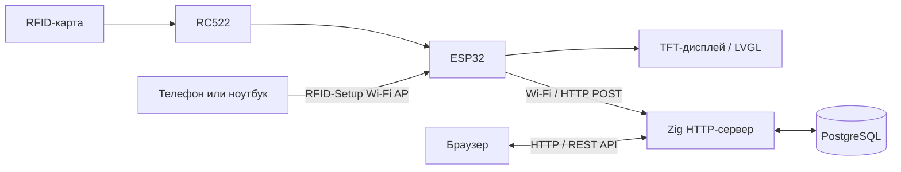
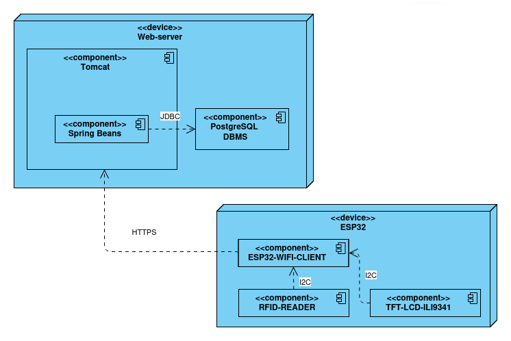
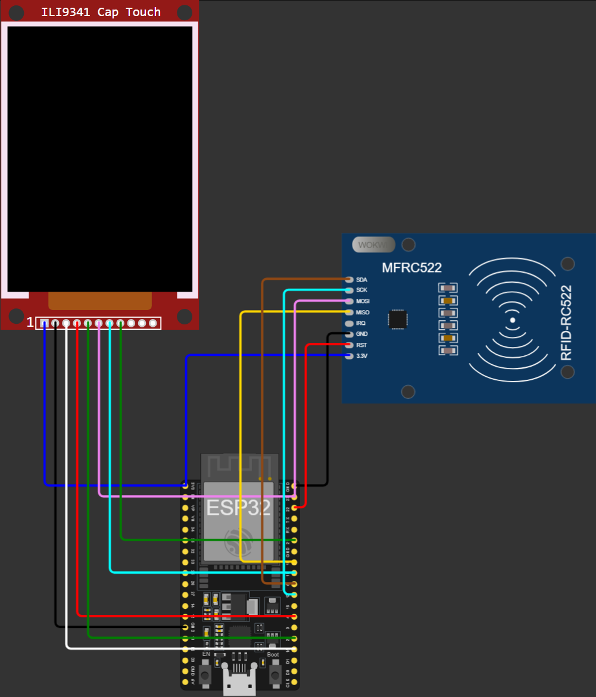

# RFID Card Manager

<p align="center">
  <strong>Программно-аппаратный комплекс для учёта выдачи и возврата оборудования с помощью RFID-карт</strong>
</p>

<p align="center">
  <a href="https://github.com/YushisNoN/RFID-card-manager">GitHub repository</a> ·
  <a href="https://github.com/YushisNoN/RFID-card-manager/branches">Все ветки</a> ·
  <a href="https://github.com/YushisNoN/RFID-card-manager/issues">Issues</a>
</p>

> [!NOTE]
> Проект разрабатывается в рамках курса «Встроенные системы». Репозиторий разделён на ветки по основным частям системы. Документация ниже описывает фактическую реализацию прототипа и отдельно отмечает функции, которые пока относятся к планам развития.

---

## Содержание

- [О проекте](#о-проекте)
- [Ветки репозитория](#ветки-репозитория)
- [Возможности текущей версии](#возможности-текущей-версии)
- [Архитектура](#архитектура)
- [Аппаратная часть](#аппаратная-часть)
- [Распиновка](#распиновка)
- [Технологии](#технологии)
- [Структура репозитория](#структура-репозитория)
- [Сценарий работы](#сценарий-работы)
- [HTTP API](#http-api)
- [Подготовка и запуск](#подготовка-и-запуск)
- [Настройка Wi-Fi на ESP32](#настройка-wi-fi-на-esp32)
- [Запуск серверной части](#запуск-серверной-части)
- [Документация исходного кода](#документация-исходного-кода)
- [Текущее состояние и ограничения](#текущее-состояние-и-ограничения)
- [Безопасность](#безопасность)
- [Команда проекта](#команда-проекта)
- [Источники](#источники)

## О проекте

**RFID Card Manager** — система учёта выдачи и возврата плат (оборудования). RFID-карта используется как идентификатор операции: контроллер считывает UID карты и передаёт его серверу. Серверная часть обрабатывает событие и сохраняет текущее состояние карты и историю операций в PostgreSQL. Веб-интерфейс отображает статистику и журнал событий.

В состав прототипа входят:

1. **Устройство на ESP32** — считывает RFID-карту, показывает состояние операции на TFT-дисплее и взаимодействует с сервером по Wi-Fi.
2. **Отдельный контроллер с камерой** — фиксирует и анализирует количество плат в шкафу
3. **Zig HTTP-сервер** — принимает UID, выполняет бизнес-логику и предоставляет REST API. Также сервер раздаёт статические файлы веб-интерфейса.
4. **PostgreSQL** — хранит текущее состояние карт и историю операций.
5. **Веб-интерфейс** — предоставляет обзор статистики и историю событий.

> [!IMPORTANT]
> В актуальной аппаратной реализации используется **RC522**, а не PN532. В README предыдущей версии были указаны PN532 и функции контроля доступа, которые не соответствуют текущему коду. Ниже приведено описание реализованного прототипа.

## Ветки репозитория

Компоненты проекта развиваются в отдельных ветках. Для перехода к нужной части используйте ссылки:

| Ветка / каталог | Содержимое |
|---|---|
| [`main`](https://github.com/YushisNoN/RFID-card-manager/tree/main) | Главная документация проекта, материалы, схемы и каталог прошивки ESP32. |
| [`server`](https://github.com/YushisNoN/RFID-card-manager/tree/server) | Серверная часть на Zig, PostgreSQL, REST API и веб-интерфейс. |
| [`esp-rfid`](https://github.com/YushisNoN/RFID-card-manager/tree/esp-rfid) | Исходный код и конфигурация прошивки RFID модуля |
| [Все ветки репозитория](https://github.com/YushisNoN/RFID-card-manager/branches) | Актуальный список веток GitHub. |

Если названия или назначение веток изменятся, актуальный список всегда доступен на странице **Branches** репозитория.

## Возможности текущей версии

### Прошивка ESP32-RFID

- Считывание UID RFID-карты с помощью RC522.
- Передача UID на сервер HTTP POST-запросом с JSON-телом.
- Подключение к пользовательской Wi-Fi сети через страницу первоначальной настройки.
- Сохранение SSID и пароля Wi-Fi в NVS.
- Автоматическая попытка подключения к сохранённой сети при запуске.
- Локальный графический интерфейс на TFT-дисплее под управлением LVGL.
- Отображение состояний ожидания карты, проверки, успешного ответа и ошибки.

### Серверная часть

- Приём UID RFID-карты через `POST /api/checkUID`.
- Преобразование UID в строковое представление для хранения в PostgreSQL.
- Учёт операций выдачи и возврата платы.
- Сохранение истории событий.
- Получение сводной статистики и истории через REST API.
- Раздача статических файлов веб-интерфейса.
- Запуск серверной части в Docker.

Подробности реализации серверной логики, схемы базы данных и всех маршрутов приведены в [README серверной ветки](https://github.com/YushisNoN/RFID-card-manager/blob/server/README.md).

## Архитектура



Основной поток обработки карты:

1. RC522 обнаруживает карту и передаёт UID прошивке.
2. ESP32 отображает состояние проверки на TFT-дисплее.
3. Прошивка формирует JSON и отправляет `POST /api/checkUID`.
4. Zig-сервер проверяет и обрабатывает UID через PostgreSQL.
5. Сервер возвращает HTTP-ответ.
6. ESP32 отображает результат операции.

Отдельно ESP32 поднимает точку доступа `RFID-Setup` с веб-страницей настройки сети. Эта точка доступа используется для настройки Wi-Fi и не заменяет серверную веб-панель.

## Аппаратная часть

Текущая конфигурация прототипа:

| Компонент | Назначение |
|---|---|
| ESP32-DevKit V1 / ESP-WROOM-32 | Центральный контроллер |
| RC522 | Считывание UID RFID-карт |
| TFT Touch Display 2.8" v1.1, контроллер ST7789V | Вывод графического интерфейса |
| RFID-карта, совместимая с используемым режимом RC522 | Идентификатор операции |
| USB-кабель / источник питания | Питание и прошивка контроллера |

Сенсорный контроллер дисплея в текущем программном интерфейсе не используется: управление состояниями выполняется прошивкой автоматически.

### Фотографии и схемы

Материалы проекта находятся в каталогах [`docs/`](docs/), [`photos/`](photos/) и [`photos_resized/`](photos_resized/), если соответствующие файлы включены в выбранную ветку.

<!-- При необходимости добавьте сюда изображения с актуальными путями из репозитория:


-->

## Распиновка

В текущей конфигурации TFT-дисплей и RC522 используют **разные SPI-хосты ESP32**.

### RC522 — SPI2_HOST

| Сигнал RC522 | GPIO ESP32 |
|---|---:|
| MISO | GPIO 19 |
| MOSI | GPIO 23 |
| SCK / SCLK | GPIO 18 |
| SDA / SS / CS | GPIO 21 |
| RST | GPIO 22 |

### TFT ST7789V — SPI3_HOST

| Сигнал дисплея | GPIO ESP32 |
|---|---:|
| CS | GPIO 15 |
| DC | GPIO 2 |
| RESET | GPIO 4 |
| MOSI | GPIO 12 |
| SCLK | GPIO 13 |
| MISO | GPIO 14 |

Разрешение дисплея в прошивке: **240 × 320** пикселей. Перед подключением модулей необходимо сверить маркировку контактов конкретной ревизии платы и дисплея.

> [!WARNING]
> Не подавайте 5 В на GPIO ESP32. Уровни логических сигналов и питание периферии должны соответствовать документации используемых модулей. Необходимо также учитывать ограничения GPIO, выбранных для конкретной платы.

## Технологии

| Область | Технология |
|---|---|
| Контроллер | ESP32 / ESP-WROOM-32 |
| Среда разработки прошивки | ESP-IDF 6.1 |
| Язык прошивки | C |
| RFID | RC522, компонент `abobija/rc522` |
| Дисплей | ST7789V, `esp_lcd` |
| Графический интерфейс | LVGL 9 через `esp_lvgl_port` |
| Хранение настроек ESP32 | NVS |
| Сетевое взаимодействие | Wi-Fi, HTTP, JSON |
| Сервер | Zig 0.17.1 |
| База данных | PostgreSQL |
| Веб-интерфейс | HTML, CSS, JavaScript |
| Контейнеризация серверной части | Docker, Docker Compose |
| Документация исходного кода C | Doxygen |

Версии Zig и серверных зависимостей относятся к серверной ветке. Настройки и зависимости прошивки определяются файлами ESP-IDF (`idf_component.yml`, `CMakeLists.txt`, `sdkconfig`).

## Структура репозитория

Структура главной ветки на верхнем уровне:

```text
RFID-card-manager/
├── .vscode/          # Настройки Visual Studio Code
├── docs/             # Документация, схемы и материалы
├── esp32/            # Прошивка ESP32
├── photos/           # Фотографии проекта
├── photos_resized/   # Подготовленные изображения
├── tools/            # Вспомогательные инструменты
└── README.md         # Главная документация
```

Серверная реализация находится в отдельной ветке [`server`](https://github.com/YushisNoN/RFID-card-manager/tree/server). Её структуру следует смотреть непосредственно в этой ветке: она может отличаться от каталога прошивки.

## Сценарий работы

### Первоначальная настройка Wi-Fi

1. При запуске ESP32 инициализирует NVS, GUI и сетевой модуль.
2. Устройство запускает точку доступа `RFID-Setup`.
3. Пользователь подключается к этой сети с телефона или компьютера.
4. В браузере открывается `http://192.168.4.1`.
5. Пользователь вводит SSID и пароль основной сети.
6. Прошивка сохраняет значения в NVS и перезапускает ESP32.
7. После перезапуска контроллер загружает сохранённые параметры и пытается подключиться к роутеру.

### Считывание карты

1. RC522 обнаруживает карту.
2. Обработчик события проверяет состояние и длину UID.
3. Прошивка показывает экран проверки.
4. `sendRequest()` отправляет UID серверу.
5. При HTTP 200 отображается успешное состояние; при сетевой ошибке или другом HTTP-статусе — состояние ошибки.

Время отображения результата на дисплее:

- Успешный результат — 5 секунд.
- Ошибка — 3 секунды.

## HTTP API

Прошивка обращается к серверному маршруту:

```http
POST /api/checkUID
Content-Type: application/json
```

Пример тела запроса:

```json
{
  "size": 4,
  "bytes": [4, 123, 22, 89]
}
```

| Поле | Тип | Назначение |
|---|---|---|
| `size` | число | Количество значимых байтов UID |
| `bytes` | массив чисел | Байты UID карты |

Прошивка проверяет размер UID и формирует JSON из значимых байтов. Текущий `sendRequest()` считает операцию успешной при HTTP-статусе **200**. Тело ответа сервера в текущей версии прошивкой не разбирается.

Сервер также предоставляет `GET /api/stats` и `GET /api/history` для веб-интерфейса. Полное описание форматов и серверных ответов находится в [документации серверной ветки](https://github.com/YushisNoN/RFID-card-manager/blob/server/README.md).

## Подготовка и запуск

### Требования

Для сборки прошивки необходимы:

- Windows 10/11 или другая ОС, поддерживаемая ESP-IDF;
- ESP-IDF **6.1**;
- Python-окружение и инструменты, устанавливаемые ESP-IDF Installer;
- CMake и Ninja (устанавливаются через ESP-IDF Tools);
- USB-драйвер для USB-UART преобразователя платы;
- плата ESP32 и подключённые модули RC522 и TFT.

Для полного запуска системы дополнительно необходимы:

- Zig **0.17.1**;
- PostgreSQL;
- Docker Engine и Docker Compose, если сервер запускается в контейнерах.

### 1. Клонирование репозитория

```powershell
git clone https://github.com/YushisNoN/RFID-card-manager.git
cd RFID-card-manager
```

Перейдите в каталог прошивки:

```powershell
cd esp32
```

Если прошивка хранится в отдельной ветке или каталоге, используйте соответствующую ссылку из раздела [Ветки репозитория](#ветки-репозитория).

### 2. Активация ESP-IDF

Для стандартной установки ESP-IDF 6.1 в PowerShell:

```powershell
& "C:\esp\v6.1\esp-idf\export.ps1"
```

Путь зависит от расположения ESP-IDF на компьютере. Проверьте окружение:

```powershell
idf.py --version
```

Ожидаемая версия — ESP-IDF 6.1.x.

### 3. Настройка Flash и таблицы разделов

Для используемой конфигурации требуется физическая Flash-память **4 МБ**. Объём можно проверить командой (замените `COM3` на порт платы):

```powershell
python -m esptool --port COM3 flash-id
```

В выводе найдите `Detected flash size: 4MB`. Настройка размера в ESP-IDF не увеличивает физическую память: выбранное значение должно соответствовать реальному объёму микросхемы.

Откройте меню конфигурации:

```powershell
idf.py menuconfig
```

В разделе `Serial flasher config` выберите:

```text
Flash size: 4 MB
```

В проекте используется собственная таблица разделов. В корне проекта прошивки (`esp32/`) должен находиться файл `partitions.csv`:

```csv
# Name,     Type, SubType, Offset,   Size,     Flags
nvs,        data, nvs,     0x9000,   0x6000,
phy_init,   data, phy,     0xf000,   0x1000,
factory,    app,  factory, 0x10000,  0x200000,
```

В `menuconfig` откройте `Partition Table` и задайте:

```text
Partition Table: Custom partition table CSV
Custom partition CSV file: partitions.csv
```

Таблица выделяет 2 МБ под приложение `factory`, 24 КБ под NVS и 4 КБ под PHY init. Оставшееся пространство Flash не размечено. В этой конфигурации не предусмотрены OTA-разделы и отдельный раздел файловой системы.

> [!IMPORTANT]
> Не выбирайте размер Flash 4 МБ, если установленная микросхема физически имеет другой объём. При изменении таблицы разделов существующие данные в Flash могут стать недоступны. Перед заменой таблицы учитывайте необходимость сохранения данных NVS.

### 4. Настройка размера стека

Для главной задачи приложения используется размер стека **8192 байта**.

Откройте:

```powershell
idf.py menuconfig
```

Найдите параметр `Main task stack size` в разделе `Component config` → `ESP System Settings` и задайте значение:

```text
8192
```

В конфигурации `sdkconfig` ему соответствует:

```text
CONFIG_ESP_MAIN_TASK_STACK_SIZE=8192
```

Это размер стека главной задачи, в которой выполняется `app_main()`. Он не изменяет размер стека задач LVGL, HTTP-сервера или других FreeRTOS-задач.

### 5. Загрузка зависимостей и сборка

В каталоге прошивки выполните:

```powershell
idf.py reconfigure
idf.py build
```

ESP-IDF Component Manager разрешает зависимости, перечисленные в `idf_component.yml`. В текущей конфигурации используется компонент RC522 и порт LVGL для ESP-IDF.

### 6. Прошивка и монитор последовательного порта

Подключите ESP32 и определите номер COM-порта. Затем выполните:

```powershell
idf.py -p COM3 flash monitor
```

Замените `COM3` на фактический порт. Для выхода из монитора обычно используется `Ctrl+]`.

Если после изменения таблицы разделов или конфигурации возникли ошибки несогласованности сборки, выполните полную очистку и соберите проект заново:

```powershell
idf.py fullclean
idf.py reconfigure
idf.py build
```

## Настройка Wi-Fi на ESP32

После запуска прошивка поднимает собственную точку доступа для первоначальной настройки:

| Параметр | Значение текущей конфигурации |
|---|---|
| SSID точки доступа | `RFID-Setup` |
| Пароль точки доступа | `rfidsetup` |
| Адрес страницы | `http://192.168.4.1` |
| Порт HTTP | `80` |

Порядок настройки:

1. Подключитесь телефоном или ноутбуком к сети `RFID-Setup`.
2. Используйте пароль, установленный в `SETUP_AP_PASSWORD` в `web.c`.
3. Откройте `http://192.168.4.1`.
4. Введите SSID и пароль Wi-Fi сети, к которой должен подключаться контроллер.
5. Отправьте форму. Прошивка сохранит настройки в NVS и перезапустит устройство.
6. После перезапуска ESP32 прочитает сохранённые значения и начнёт подключение в режиме станции.

В текущем варианте точка доступа настройки остаётся запущенной одновременно с режимом STA. Это позволяет повторно открыть страницу настройки, находясь в сети `RFID-Setup`.

> [!WARNING]
> `rfidsetup` — тестовый пароль из текущей конфигурации. Перед эксплуатацией его необходимо заменить на собственный. Страница настройки не реализует полноценную пользовательскую авторизацию.

## Запуск серверной части

Серверная часть находится в ветке [`server`](https://github.com/YushisNoN/RFID-card-manager/tree/server). В ней описаны структура Zig-проекта, схема PostgreSQL, REST API, переменные окружения и варианты локального запуска и запуска через Docker Compose.

Чтобы получить серверную ветку отдельно:

```powershell
git clone --branch server --single-branch https://github.com/YushisNoN/RFID-card-manager.git
```

Дальнейшие действия:

1. Подготовьте PostgreSQL и базу данных.
2. Настройте `DATABASE_URL` в переменных окружения сервера.
3. Выберите локальный запуск через Zig или контейнерный запуск через Docker Compose.
4. Убедитесь, что сервер доступен из сети, к которой подключена ESP32.
5. Настройте URL сервера в прошивке (`SERVER_URL` в `web.c`).

Подробные команды и актуальная конфигурация приведены в [README ветки server](https://github.com/YushisNoN/RFID-card-manager/blob/server/README.md).

> [!IMPORTANT]
> Адрес `SERVER_URL` должен быть доступен из Wi-Fi сети ESP32. Не используйте `localhost` в прошивке: для контроллера это будет сам ESP32, а не компьютер с сервером. Укажите IP-адрес или DNS-имя хоста, доступное из локальной сети.

## Документация исходного кода

Комментарии в исходных файлах C и заголовках оформляются в стиле **Doxygen**. Для генерации HTML-документации используется файл `Doxyfile`, расположенный в корне каталога прошивки.

### Установка Doxygen

Установите Doxygen для своей операционной системы. Официальная страница загрузки:

- [Doxygen — Downloads](https://www.doxygen.nl/download.html)

После установки проверьте доступность команды:

```powershell
doxygen --version
```

Если команда не найдена, добавьте каталог `doxygen\bin` в `PATH` или запускайте `doxygen.exe` по полному пути.

### Генерация документации

Перейдите в каталог прошивки, где расположен `Doxyfile`, и выполните:

```powershell
New-Item -ItemType Directory -Force .\docs\doxygen | Out-Null
doxygen .\Doxyfile
```

При корректной конфигурации HTML-документация будет создана в каталоге, указанном параметром `OUTPUT_DIRECTORY` в `Doxyfile` (для конфигурации проекта — `docs/doxygen/html`).

Откройте стартовую страницу:

```powershell
Start-Process .\docs\doxygen\html\index.html
```

Если путь вывода в `Doxyfile` отличается, используйте соответствующий каталог. Для обновления документации после изменения комментариев достаточно повторно выполнить `doxygen .\Doxyfile`.

### Комментарии Doxygen

Для описания функций используется формат:

```c
/**
 * @brief Краткое назначение функции.
 *
 * @details Подробное описание логики и особенностей работы.
 *
 * @param uid Идентификатор RFID-карты.
 * @return ESP_OK при успешном выполнении, код ошибки в противном случае.
 */
```

Для модулей, структур и перечислений применяются `@file`, `@struct`, `@enum`, `@brief`, `@details`, `@note` и `@warning`.

Рекомендуется генерировать документацию после каждого значимого изменения публичного интерфейса или поведения модуля.

## Текущее состояние и ограничения

README отражает текущую реализацию прототипа. Следующие функции не следует считать реализованными, пока они не появятся в коде и не будут проверены:

- полноценная регистрация пользователей и привязка нескольких ролей к карте;
- административная блокировка и удаление карт через веб-панель;
- локальный кэш карт и автономная проверка при недоступности сервера;
- криптографическая аутентификация карты по challenge-response;
- шифрование прикладного обмена с помощью AES/HMAC;
- HTTPS между ESP32 и сервером;
- разбор JSON-ответа сервера на ESP32 и раздельное отображение операций выдачи и возврата.

В текущем коде прошивка проверяет HTTP-статус `200`, но не анализирует JSON-поле `status`. Поэтому графический интерфейс показывает общий успешный результат, а не отдельные сообщения для `board_taken` и `board_returned`.

Серверная ветка описывает переключение состояния карты между выдачей и возвратом при повторном считывании. Подробности и ограничения серверного алгоритма приведены в README этой ветки.

## Безопасность

- Не публикуйте пароли Wi-Fi, токены, приватные ключи, реальные строки подключения к PostgreSQL и другие секреты в Git.
- Измените тестовый пароль точки доступа `RFID-Setup` перед использованием устройства вне лабораторной среды.
- Настройки Wi-Fi сохраняются в NVS. Не следует считать это эквивалентом отдельной криптографической защиты сохранённых данных.
- В текущем примере URL сервера использует HTTP. Такой обмен не обеспечивает конфиденциальность и проверку подлинности сервера на транспортном уровне.
- UID RFID-карты используется как идентификатор, но сам по себе не является криптографическим доказательством подлинности карты.
- Не размещайте тестовый HTTP-сервер и страницу настройки в недоверенной сети без дополнительной защиты.

Перед публикацией проверьте историю Git на случайно добавленные секреты. Если секрет уже был опубликован, одной очистки текущего файла недостаточно: значение следует заменить в соответствующем сервисе.

## Команда проекта

| Участник | Область ответственности |
|---|---|
| Чайковский Никита | Бизнес-логика, криптография, работа со считывателем |
| Никитенко Матвей | Макет в Wokwi, проектирование базы данных, веб-сервер, GUI |
| Деревянко Владимир | Веб-сервер, обмен с сервером, GUI |

Распределение отражает указанное командой разделение задач и может уточняться по мере развития проекта.

## Испытания и дальнейшее развитие

Для проверки прототипа рекомендуется последовательно выполнить следующие сценарии:

- проверка обнаружения RFID-карты и корректности чтения UID;
- проверка отображения состояний на TFT-дисплее;
- первоначальная настройка Wi-Fi и сохранение параметров после перезапуска;
- подключение к сохранённой Wi-Fi сети после выключения питания;
- отправка UID на доступный сервер;
- обработка отсутствия Wi-Fi и недоступности сервера;
- проверка серверной записи события и обновления статистики;
- проверка повторного считывания одной карты и соответствующего изменения состояния в базе.

Результаты испытаний и известные проблемы рекомендуется фиксировать в Issues репозитория.

## Источники

- ГОСТ 19.201-78. Техническое задание. Требования к содержанию и оформлению.
- [Документация ESP-IDF](https://docs.espressif.com/projects/esp-idf/)
- [Документация LVGL](https://docs.lvgl.io/)
- [Документация Doxygen](https://www.doxygen.nl/manual/)
- [Репозиторий RFID Card Manager](https://github.com/YushisNoN/RFID-card-manager)
